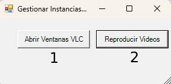

# Multi VLC Manager
(Esta documentación fue generada con modelos de Lenguaje)

**Multi VLC Manager** es una aplicación para Windows que permite abrir múltiples instancias de **VLC Media Player** y reproducir el mismo video en todas de forma sincronizada. Así, un video con varias pistas de audio (por ejemplo español, francés e inglés) puede sonar en todos los idiomas a la vez, cada uno en su propia ventana y salida de audio.
---

## 📋 **Características**
- Abre **varias instancias de VLC Media Player** al mismo tiempo (3 por defecto, configurable hasta 8).
- Permite reproducir **videos con diferentes audios** simultáneamente.
- Interfaz amigable con opciones para abrir y reproducir videos fácilmente.
- Instalación sencilla, sin permisos de administrador.
- Verifica automáticamente si **VLC está instalado** y guía al usuario para descargarlo si no lo está.

---

## 💻 **Requisitos del Sistema**
1. **Sistema Operativo**: Windows 10 o superior.
2. **Software Requerido**:
   - [VLC Media Player](https://www.videolan.org/vlc/index.html) (versión 3.0 o superior).
3. **Espacio en Disco**: Menos de 1 MB.

---

## 🚀 **Instalación**
1. **Descarga el ZIP**: en la [página del proyecto](https://github.com/danielpgp1012/MULTI_VLC), haz clic en el botón verde **Code** → **Download ZIP**.
2. **Desbloquea el ZIP**: clic derecho sobre el archivo descargado → **Propiedades** → marca **Desbloquear** → **Aceptar**. Así Windows no bloqueará los archivos al ejecutarlos.
3. **Extrae el ZIP** y haz doble clic en **`Instalar.cmd`**.
   - Si Windows muestra "Windows protegió su PC", haz clic en **Más información** → **Ejecutar de todas formas**.
4. Se crea el acceso directo **Multi VLC Manager** en el escritorio y en el menú Inicio. La carpeta del ZIP ya se puede borrar.

Si VLC no está instalado, la aplicación lo indicará al abrirse y abrirá la página oficial de descarga.

**Actualizar**: repite los mismos pasos; `Instalar.cmd` reemplaza la versión anterior.

---

## 🛠️ **Uso**
1. Abre **Multi VLC Manager** desde el acceso directo en el escritorio o el menú Inicio.
      <br>
    
2. Elige el **número de ventanas** (3 por defecto) y haz clic en **"Abrir Ventanas VLC"** para seleccionar un archivo de video.
   <br>
   

3. La aplicación abrirá el número de instancias de VLC elegido. Si ya había ventanas abiertas, preguntará si quieres cerrarlas primero.
4. Selecciona los idiomas y canales correctos en cada ventana.
5. Haz clic en **"Reproducir Videos"** para iniciar la reproducción simultánea en todas las ventanas.

---

### **🛠️ Mantenimiento**

No hay ejecutable ni paso de compilación: la aplicación es el archivo `multi_vlc.ps1`.

- Para cambiar algo, edita `multi_vlc.ps1` y súbelo a GitHub. En la PC de la iglesia, repite los pasos de instalación.
- Para probar un cambio sin instalar: `powershell -ExecutionPolicy Bypass -File .\multi_vlc.ps1`
- Guarda los archivos `.ps1` como **UTF-8 con BOM** (en VS Code: "Save with Encoding" → "UTF-8 with BOM"). Sin el BOM, Windows PowerShell muestra mal los acentos (por ejemplo "Número" en lugar de "Número").

---

## 📦 **Estructura del Proyecto**
```plaintext
Multi VLC Manager/
├── multi_vlc.ps1                # La aplicación
├── Instalar.cmd                 # Doble clic para instalar o actualizar
├── instalar.ps1                 # Lógica de instalación (copia archivos y crea accesos directos)
├── assets/multi_vlc_icon.ico    # Icono de la aplicación
├── README.md                    # Este archivo
```

---

## 🧩 **Desinstalación**
Borra el acceso directo **Multi VLC Manager** del escritorio y del menú Inicio, y la carpeta `%LOCALAPPDATA%\MultiVLCManager` (pégala en la barra de direcciones del Explorador de archivos).

---

## 📄 **Licencia**
Este proyecto está bajo la licencia **MIT**. Consulta el archivo [LICENSE](https://github.com/danielpgp1012/MULTI-VLC/blob/main/LICENSE) para más detalles.

---

## 🤝 **Contribuciones**
¡Las contribuciones son bienvenidas!